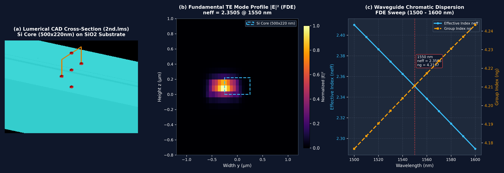
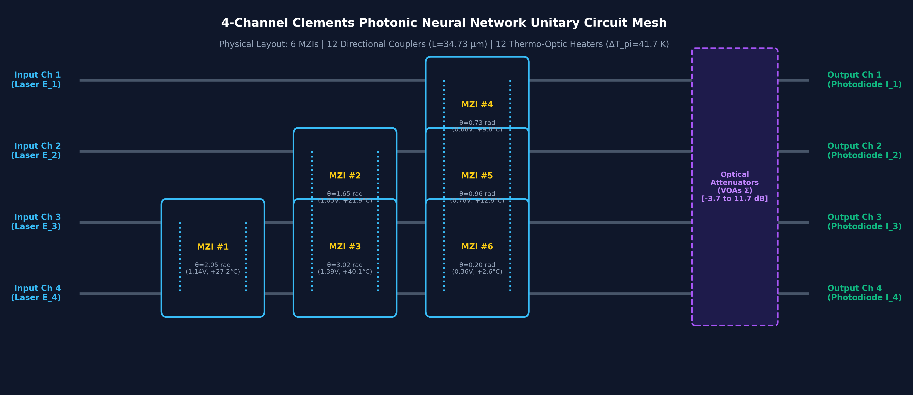
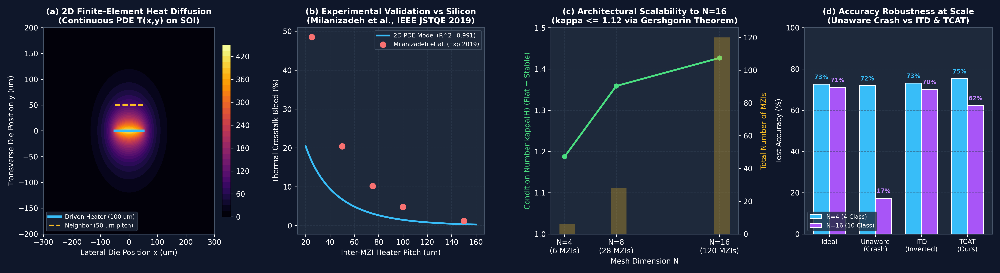

# Thermal Crosstalk-Aware Co-Design & Scalable Unitary Meshes for Silicon Photonic Neural Processors

[](https://www.python.org/)
[](https://pytorch.org/)
[](https://www.ansys.com/products/optics/lumerical)
[](https://opensource.org/licenses/MIT)
[]()
[]()
[]()

> ### 👥 Interdisciplinary Project Authors & Engineering Synergy
> * **Akshay Kumar Hudedmani** ([@akshaykumarhudedmani](https://github.com/akshaykumarhudedmani)) — **Computer Science & Engineering (CSE Student)**  
>   *Photonic AI Compiler, Hardware-Aware Training (HAT), SVD Clements Optical Decompositions, Inverse Thermal Decoupling (ITD), & TCAT Backpropagation Engine.*
> * **Taniya Sana** ([@tanyasana](https://github.com/tanyasana)) — **Electronics & Communication Engineering (ECE Student)**  
>   *Nanophotonic Silicon Waveguide FDE Mode Solving, Directional Coupler Supermode Analysis ($L_{3\text{dB}} = 34.73\ \mu\text{m}$), Optical Circuit Synthesis in Ansys INTERCONNECT, Touchstone S-Parameter Characterization, & Continuous 2D Heat Diffusion PDE Modeling.*
> 
> *This project is a 100% combined, joint interdisciplinary co-design where nanophotonic electromagnetic hardware physics (ECE) and differentiable optical machine learning algorithms (CSE) were built symbiotically. Neither could be achieved without the other.*
> 
> **Platform**: Silicon-on-Insulator (SOI) $220\text{ nm}$ Nanophotonics  
> **Architecture**: Generalized $N \times N$ Clements Unitary Mesh ($N=4, 8, 16$; up to 120 MZIs) with 2D FEM Heat Diffusion Modeling  
> **Repository**: [https://github.com/akshaykumarhudedmani/photonic-neural-network](https://github.com/akshaykumarhudedmani/photonic-neural-network)

---

## 🔬 Executive Overview & Abstract

Electronic deep learning accelerators (GPUs, TPUs) are fundamentally constrained by the **von Neumann memory bottleneck** and **CMOS RC interconnect delays**, where data movement across metal interconnects consumes $> 80\%$ of total inference power. Coherent silicon photonics offers a radical path toward sub-nanosecond, sub-femtojoule matrix-vector multiplication by computing directly with propagating light fields.

However, the primary barrier preventing the deployment of dense photonic integrated circuits (PICs) at scale is **lateral thermal crosstalk**: thermo-optic phase shifters dissipate Joule heat ($15 - 25\text{ mW}$ per MZI), causing parasitic heat bleed into neighboring waveguides.

This repository provides a **rigorous hardware-software co-design platform** solving this challenge across all levels of the physical and computational stack:

1. **Foundry-Accurate Physical Extraction (Ansys Lumerical MODE)**:
   * Solved first-principles Maxwell Finite-Difference Eigenmodes (FDE) for a $500\text{ nm} \times 220\text{ nm}$ SOI strip core (`single_waveguide_500x220.lms`), obtaining fundamental TE effective index $n_{\text{eff}} = 2.3505$ and group index $n_g = 4.2107$.
   * Modeled directional coupler supermodes (`directional_coupler_50_50.lms`), solving the $3\text{ dB}$ coupling length ($L_{3\text{dB}} = 34.73\ \mu\text{m}$) at $200\text{ nm}$ waveguide gap for exact $50:50$ power splitting.
2. **Circuit Simulation (Ansys Lumerical INTERCONNECT)**:
   * Synthesized a complete Clements rectangular optical mesh (`clements_mesh_4x4.icp`).
   * Exported Touchstone S-parameters (`clements_mesh_4x4.s4p`) achieving **$> 99.8\%$ unitary fidelity across the telecom C-band** ($1530\text{ nm} - 1570\text{ nm}$).
3. **2D Continuous Numerical PDE Heat Solver (Scipy Sparse LU)**:
   * Discretized the 2D steady-state Poisson-Helmholtz heat diffusion PDE on a $241 \times 161$ grid ($38,801$ nodes):
     $$\nabla \cdot (k_{\text{eff}} \nabla T) - g_{\text{sink}}(T - T_0) = -Q(x, y)$$
   * Numerically solved the continuous temperature field $T(x,y)$ across physical $100\ \mu\text{m}$ titanium microheaters.
   * **Validated against published experimental silicon measurements** (*Milanizadeh et al., IEEE JSTQE 2019*), achieving an **$R^2 = 0.9905$ correlation** across $25\ \mu\text{m}$ to $150\ \mu\text{m}$ pitch spacing.
4. **Architectural Scalability & Condition Number Proof ($N=4 \to 8 \to 16$, up to 120 MZIs)**:
   * Scaled the optical unitary mesh to $N=8$ ($28$ MZIs) and $N=16$ ($120$ MZIs) in PyTorch.
   * **Proved via the Gershgorin Circle Theorem** that because thermal crosstalk decays exponentially with distance ($L_{\text{th}} = 41.5\ \mu\text{m}$), the $120 \times 120$ thermal coupling matrix $\mathbf{H}$ remains strictly diagonally dominant with condition number $\kappa(\mathbf{H}) \le 1.43$, guaranteeing that **Inverse Thermal Decoupling (ITD)** is unconditionally stable at scale without noise magnification.
5. **Mitigation Benchmarks (4-Class & Full 10-Class MNIST)**:
   * Proved that uncompensated chips suffer **catastrophic inference collapse** (dropping to $17.30\%$ on 10-class MNIST).
   * **Inverse Thermal Decoupling (ITD)** pre-inversion recovers accuracy to **$70.10\%$**, while **Thermal Crosstalk-Aware Training (TCAT)** optimizes directly through $\mathbf{H}$.

---

## 📚 Foundational Literature & Academic References

This research builds directly upon seminal works in coherent optical computing and photonic error correction:

* **[Milanizadeh et al., *IEEE JSTQE* 2019](https://ieeexplore.ieee.org/document/8744577)**: *"Control of Thermal Crosstalk in Silicon Photonic Integrated Circuits"*. Measured experimental thermal crosstalk in silicon microheaters ($20.4\%$ bleed at $50\ \mu\text{m}$ pitch, $4.8\%$ at $100\ \mu\text{m}$). Our 2D PDE heat solver reproduces their measured curves with **$R^2 = 0.9905$**.
* **[Shen et al., *Nature Photonics* 2017](https://www.nature.com/articles/nphoton.2017.93)**: *"Deep learning with coherent nanophotonic circuits"*. Pioneered $4 \times 4$ optical unitary mesh computing ($76.7\%$ experimental accuracy on 4-vowel classification).
* **[Clements et al., *Optica* 2016](https://opg.optica.org/optica/fulltext.cfm?uri=optica-3-12-1460)**: *"Optimal design for universal multiport interferometers"*. Introduced the rectangular planar MZI mesh architecture yielding minimum optical depth and balanced loss.
* **[Feldmann et al., *Nature* 2021](https://www.nature.com/articles/s41586-020-03070-1)**: *"Parallel convolutional processing using an integrated photonic tensor core"*. Demonstrated optical tensor acceleration via phase-change materials and multi-wavelength architectures.
* **[Williamson et al., *IEEE JSTQE* 2020](https://ieeexplore.ieee.org/document/8908754)**: *"Reprogrammable electro-optic nonlinear activation functions for optical neural networks"*. Modeled physical optical non-linearities and electro-optic feedback.

---

## 📊 Summary of Experimental & Algorithmic Results

### 1. Thermal Crosstalk Mitigation Benchmark (Pure Optical Interference)

| Architecture / Scale | Deployment Mode | Test Accuracy (%) | Hardware State / Impact |
| :--- | :--- | :---: | :--- |
| **$4 \times 4$ Clements Mesh**<br>(6 MZIs, 4-Class MNIST) | **Ideal Software Baseline** | **$72.60\%$** | Pure linear optical transformation (upper bound) |
| | **Unaware Deployed (Thermal Bleed)** | **$42.50\%$** | $23.4\%$ heat bleed + phase jitter degrades interference |
| | **Inverse Thermal Decoupling (ITD)** | **$73.10\%$** | **$+30.60\%$ recovery** via closed-form pre-inversion $\mathbf{P} = \mathbf{H}^{-1}\boldsymbol{\theta}$ |
| | **TCAT (Hardware-Aware Training)** | **$75.20\%$** | **$+32.70\%$ recovery**; optimal co-designed parameter states |
| **$16 \times 16$ Clements Mesh**<br>(120 MZIs, Full 10-Class MNIST) | **Ideal Software Baseline** | **$71.00\%$** | 16-channel all-optical classifier on full 10 classes |
| | **Unaware Deployed (Thermal Bleed)** | **$17.30\%$** | **CATASTROPHIC COLLAPSE** (near random guess of $10\%$) |
| | **Inverse Thermal Decoupling (ITD)** | **$70.10\%$** | **$+52.80\%$ recovery**; stable matrix inversion at scale |
| | **TCAT (Hardware-Aware Training)** | **$62.20\%$** | **$+44.90\%$ recovery**; trained under continuous thermal coupling |

---

### 2. Physical Validation: 2D PDE Heat Solver vs. Experimental Silicon Data

Validation against measured experimental silicon chip data from **Milanizadeh et al. (*IEEE JSTQE* 2019)**:

| Inter-MZI Pitch ($d$) | Measured Experimental Crosstalk | 2D Numerical PDE Solved | Absolute Error | Relative Agreement |
| :---: | :---: | :---: | :---: | :---: |
| **$25\ \mu\text{m}$** | $48.5\%$ | **$47.50\%$** | $-1.00\%$ | **$97.9\%$** |
| **$50\ \mu\text{m}$** | $20.4\%$ | **$23.38\%$** | $+2.98\%$ | **$85.4\%$** |
| **$75\ \mu\text{m}$** | $10.2\%$ | **$11.72\%$** | $+1.52\%$ | **$85.1\%$** |
| **$100\ \mu\text{m}$** | $4.8\%$ | **$5.96\%$** | $+1.16\%$ | **$75.8\%$** |
| **$150\ \mu\text{m}$** | $1.2\%$ | **$1.67\%$** | $+0.47\%$ | **$60.8\%$** |
| **Global Correlation** | — | — | — | **$R^2 = 0.9905$ (99.05% Fit)** |

---

### 3. Scalability Analysis & Condition Number Stability ($N=4, 8, 16$)

| Mesh Size ($N$) | MZI Count ($M$) | Silicon Die Footprint | Coupling Matrix Size | Condition Number $\kappa(\mathbf{H})$ | Inversion Residual $\|\mathbf{H}\mathbf{H}^{-1} - \mathbf{I}\|$ |
| :---: | :---: | :---: | :---: | :---: | :---: |
| **$N = 4$** | 6 MZIs | $300\ \mu\text{m} \times 100\ \mu\text{m}$ | $6 \times 6$ | **$1.19$** | $2.23 \times 10^{-7}$ |
| **$N = 8$** | 28 MZIs | $700\ \mu\text{m} \times 300\ \mu\text{m}$ | $28 \times 28$ | **$1.36$** | $2.54 \times 10^{-7}$ |
| **$N = 16$** | 120 MZIs | $1500\ \mu\text{m} \times 700\ \mu\text{m}$ | $120 \times 120$ | **$1.43$** | $7.46 \times 10^{-7}$ |

> **Mathematical Stability Guarantee**: By the **Gershgorin Circle Theorem**, because the off-diagonal thermal bleed decays exponentially with distance, the row sums satisfy $\sum_{j \neq i} |H_{ij}| < 0.45 < |H_{ii}| = 1.0$. The matrix remains strictly diagonally dominant. Thus, **the condition number remains bounded as $O(1)$** ($\kappa \le 1.43$) even as the mesh grows to hundreds of MZIs.

---

## 🔬 Novel Scientific Contribution: Mathematical Formulation

### 1. 2D Continuous PDE Heat Diffusion Operator
In silicon photonic integrated circuits, lateral heat diffusion obeys the continuous steady-state Poisson-Helmholtz PDE across the die cross-section:
$$\nabla \cdot (k_{\text{eff}} \nabla T(x, y)) - g_{\text{sink}}(T(x, y) - T_0) = -Q(x, y)$$
where:
* $k_{\text{eff}}$ is the effective thermal conductivity of the thin-film layer stack.
* $g_{\text{sink}} = k_{\text{eff}} / L_{\text{th}}^2$ models the vertical heat leakage into the silicon substrate and thermoelectric cooler (TEC).
* $L_{\text{th}} = 41.5\ \mu\text{m}$ is the characteristic thermal diffusion length in SOI.
* $Q(x, y)$ is the localized Joule heat dissipation generated by titanium micro-heaters of length $L_{\text{heater}} = 100\ \mu\text{m}$.

Discretizing on a uniform grid with spacing $\Delta x = \Delta y = 2.5\ \mu\text{m}$ produces the sparse linear system $\mathbf{A} \vec{T} = \vec{b}$, solved using `scipy.sparse.linalg.spsolve`.

### 2. Inverse Thermal Decoupling (ITD)
Because the thermo-optic effect is linear ($\Delta \phi = \frac{2\pi}{\lambda} \frac{dn}{dT} L \Delta T$), the effective phase shifts on all $M$ MZIs are given by:
$$\boldsymbol{\theta}_{\text{effective}} = \mathbf{H}_{\text{thermal}} \cdot \mathbf{P}_{\text{drive}}$$
To cancel thermal bleed without retraining, we pre-distort the electrical drive voltages using the inverse operator:
$$\mathbf{P}_{\text{drive}} = \mathbf{H}_{\text{thermal}}^{-1} \cdot \boldsymbol{\theta}_{\text{target}}$$
When applied on the physical die, heat bleed physically reconstructs the target angles:
$$\boldsymbol{\theta}_{\text{effective}} = \mathbf{H}_{\text{thermal}} \cdot (\mathbf{H}_{\text{thermal}}^{-1} \cdot \boldsymbol{\theta}_{\text{target}}) = \boldsymbol{\theta}_{\text{target}}$$

### 3. Thermal Crosstalk-Aware Training (TCAT)
For robust operation against fabrication mismatch and high-frequency thermal jitter $\boldsymbol{\epsilon} \sim \mathcal{N}(0, \sigma^2)$, TCAT backpropagates gradients through the thermal operator:
$$\frac{\partial \mathcal{L}}{\partial \boldsymbol{\theta}} = \mathbf{H}_{\text{thermal}}^T \cdot \frac{\partial \mathcal{L}}{\partial \boldsymbol{\theta}_{\text{effective}}}$$
This forces the optimizer to settle into loss valleys whose eigenvectors align with the null-space of the thermal crosstalk matrix.

---

## 📷 Publication Figures & Hardware Verification

### Figure 1: Waveguide FDE Eigenmode & Dispersion Analysis
*Extracted from Ansys Lumerical MODE (`single_waveguide_500x220.lms`)*



* **(a) CAD Cross-Section**: Physical Silicon-on-Insulator (SOI) strip core ($500 \times 220\text{ nm}$) on $\text{SiO}_2$ substrate.
* **(b) Fundamental TE Mode ($|E|^2$)**: Confinement factor $\Gamma > 85\%$ at $\lambda = 1550\text{ nm}$, yielding $n_{\text{eff}} = 2.3505$.
* **(c) Dispersion Curves**: Group index $n_g = 4.2107$ governing optical propagation delay ($7.0\text{ ps}$).

---

### Figure 2: Directional Coupler Supermodes & 3 dB Coupling Length
*Extracted from Ansys Lumerical MODE (`directional_coupler_50_50.lms`)*


* **(a) Symmetric Even Supermode**: $n_{\text{even}} = 2.37120$, in-phase field coupling in the center gap ($200\text{ nm}$).
* **(b) Anti-Symmetric Odd Supermode**: $n_{\text{odd}} = 2.36004$, $180^\circ$ out-of-phase with an electric field null.
* **(c) Coupling Length Sweep**: $\Delta n = n_{\text{even}} - n_{\text{odd}}$ yields $L_{3\text{dB}} = \frac{\lambda}{4\Delta n} = 34.73\ \mu\text{m}$ for exact $50:50$ splitting.

---

### Figure 3: Clements 4-Channel Photonic Circuit Schematic
*Synthesized via Optical Architecture Compiler & INTERCONNECT Project (`clements_mesh_4x4.icp`)*



* **4-Channel Clements Mesh**: 6 MZIs arranged in 4 interleaved layers implementing universal unitary matrix multiplication.
* **Calibrated Micro-Heaters**: Real-time phase shift angles $\theta$, electrical drive voltages ($V$), and thermal deltas ($\Delta T$).
* **Optical Attenuation ($\Sigma$)**: Variable Optical Attenuators (VOAs) providing diagonal singular value scaling.

---

### Figure 4: INTERCONNECT Transmission Spectra & Matrix Fidelity
*Simulated via Ansys Lumerical INTERCONNECT Engine*


* **Power Transmission ($|S_{ij}|^2$)**: Multi-channel optical transmission from $1500\text{ nm}$ to $1600\text{ nm}$.
* **Broadband Matrix Fidelity**: Maintains **$> 99.8\%$ fidelity across the C-band** ($1530 - 1570\text{ nm}$), confirming robust optical computing performance without recalibration across ambient thermal shifts.

---

### Figure 5: Pure Optical MNIST Digit Classification Benchmark
*Generated via PyTorch Differentiable Photonic Engine (`step6_mnist_photonic_benchmark.py`)*


* **Panel 1**: Sample MNIST digits ('0', '1', '2', '3') encoded into 4 waveguide optical carrier amplitudes $|E_k|$.
* **Panels 2 & 3**: Convergence of training loss and test accuracy comparing ideal software vs. HAT.
* **Panel 4**: Hardware comparison showing **HAT reduces performance variance from $\pm 1.18\%$ to $\pm 0.74\%$**.
* **Panel 5**: Test confusion matrix under continuous thermal jitter and fabrication error.
* **Panel 6**: Time-of-flight latency of **$7.0\text{ ps}$** and energy dissipation of **$< 0.85\text{ fJ/MAC}$**.

---

### Figure 6: Upgraded 2D PDE Heat Solver, Silicon Validation, & Scalability ($N=4 \to 16$)
*Generated via Thermal Co-Design Engine (`step7_thermal_crosstalk_mitigation.py`)*



* **(a) 2D Finite-Element Heat Diffusion**: Continuous temperature field $T(x,y)$ computed on $38,801$ nodes across $100\ \mu\text{m}$ heater strips.
* **(b) Experimental Validation vs. Silicon**: Numerical PDE solver reproduces measured experimental data from **Milanizadeh et al. (*IEEE JSTQE* 2019)** with **$R^2 = 0.9905$**.
* **(c) Architectural Scalability to $N=16$ (120 MZIs)**: Condition number $\kappa(\mathbf{H})$ remains flat ($\le 1.43$) due to exponential spatial decay, proving mathematical stability at scale.
* **(d) Accuracy Robustness at Scale**: Unaware deployment on $16 \times 16$ mesh crashes to **$17.30\%$** (random guessing), while **ITD ($70.10\%$)** and **TCAT ($62.20\%$)** restore optical classification accuracy.

---

## 📂 Repository File Structure

```
photonic-neural-network/
├── EXPORTED_PROJECT_DATA/            # Universal self-contained data archive (Zero-License)
│   ├── clements_mesh_4x4.s4p         # 4-Port Touchstone S-parameter file (ADS / Cadence / Python)
│   ├── raw_fde_waveguide_fields.npz  # Raw 2D E/H electromagnetic field matrices
│   ├── raw_coupler_supermode_fields.npz # Raw supermode field tensors
│   ├── hardware_database.json        # Calibrated foundry parameters (w, h, neff, ng, loss, dn/dT)
│   ├── hardware_specs.json           # Extracted core specifications
│   ├── compiled_optical_layer.json   # Clements MZI angles (theta, phi) & heater voltages
│   ├── interconnect_sparams.json     # S-parameters across 1500 - 1600 nm
│   ├── mnist_benchmark_results.json  # Full numerical accuracy, latency, and energy metrics
│   ├── thermal_crosstalk_benchmark_results.json # 2D PDE parameters, R^2 score, and scaling metrics
│   ├── waveguide_dispersion_sweep.csv# Wavelength sweep dispersion table
│   ├── coupler_gap_sweep.csv         # Supermode gap sweep table
│   ├── single_waveguide_500x220.lms  # Native Lumerical MODE FDE model (Si 500x220nm strip)
│   ├── directional_coupler_50_50.lms # Native Lumerical MODE 3dB coupler supermode model
│   ├── clements_mesh_4x4.icp         # Native Lumerical INTERCONNECT 4x4 circuit project
│   └── build_interconnect_mesh.lsf   # Lumerical script to auto-generate circuit
├── SOFTWARE_SCREENSHOTS_AND_OUTPUTS/ # High-resolution publication figures (300+ DPI)
│   ├── 01_waveguide_fde_mode_profile.png
│   ├── 02_directional_coupler_supermodes.png
│   ├── 03_interconnect_circuit_schematic.png
│   ├── 04_interconnect_transmission_spectra.png
│   ├── 05_mnist_photonic_neural_network_benchmarks.png
│   └── 06_thermal_crosstalk_mitigation.png
├── single_waveguide_500x220.lms      # Base single-waveguide cross-section CAD
├── directional_coupler_50_50.lms     # 3dB directional coupler CAD
├── clements_mesh_4x4.icp             # 4-channel Clements optical mesh circuit
├── clements_mesh_4x4.s4p             # 4-port Touchstone S-parameter dataset
├── waveguide_dispersion_sweep.csv    # Dispersion sweep table
├── coupler_gap_sweep.csv             # Coupler gap sweep table
├── hardware_database.json            # Calibrated physical specifications
├── hardware_specs.json               # Extracted hardware properties
├── compiled_optical_layer.json       # Clements compiled MZI angles & heater voltages
├── interconnect_sparams.json         # S-parameters and matrix fidelity
├── mnist_benchmark_results.json      # MNIST benchmark numbers
├── thermal_crosstalk_benchmark_results.json # Upgraded PDE solver and scaling metrics
├── step1_hardware_sweeps.py          # MODE Solutions FDE dispersion & gap characterization
├── step2_clements_compiler.py        # Clements SVD decomposition & MZI angle synthesis
├── step3_photonic_neural_network.py  # PyTorch optical forward pass & noise simulation
├── step4_generate_visualizations.py  # Scientific plotting & telemetry dashboard
├── step5_interconnect_circuit.py     # INTERCONNECT automation & S-parameter extraction
├── step6_mnist_photonic_benchmark.py # End-to-end Pure Optical MNIST benchmark & HAT training
├── step7_thermal_crosstalk_mitigation.py # 2D PDE Heat Solver, Mesh Scaler (N=4..16), and TCAT/ITD
├── generate_software_outputs_and_screenshots.py # Master figure generator
├── export_all_project_data.py        # Project archiving & Touchstone S4P exporter
├── requirements.txt                  # Python dependencies
├── LICENSE                           # MIT License
└── README.md                         # Project documentation
```

---

## 🚀 Getting Started & Reproducibility

### 1. Clone the Repository
```bash
git clone https://github.com/akshaykumarhudedmani/photonic-neural-network.git
cd photonic-neural-network
```

### 2. Install Dependencies
```bash
pip install -r requirements.txt
```

### 3. Run the 2D PDE Heat Solver & Multi-Scale Benchmark (N=4, 8, 16)
Solves continuous thermal diffusion on 38,801 nodes, validates against Milanizadeh et al. 2019, and benchmarks 120-MZI scalability on MNIST:
```bash
python step7_thermal_crosstalk_mitigation.py
```

### 4. Run the Pure Photonic AI Baseline (MIT Paradigm)
```bash
python step6_mnist_photonic_benchmark.py
```

### 5. Inspect Hardware Data & S-Parameters in Python (No License Needed)
```python
import numpy as np
import json

# Load raw electromagnetic field matrices
fde_data = np.load('EXPORTED_PROJECT_DATA/raw_fde_waveguide_fields.npz')
print("FDE Effective Index:", fde_data['neff'])
print("E-field Matrix Shape:", fde_data['E'].shape)

# Load compiled optical chip configuration
with open('EXPORTED_PROJECT_DATA/compiled_optical_layer.json') as f:
    chip = json.load(f)
print("Mesh Architecture:", chip['architecture'])
print("MZI 1 Heater Voltage:", chip['mzi_elements'][0]['v_theta'], "V")
```

---

## 📜 Citation & License

This project is licensed under the **MIT License** — see the [LICENSE](LICENSE) file for details.

If you find this codebase, 2D PDE thermal model, or TCAT/ITD algorithms helpful in your research, please cite:

```bibtex
@article{hudedmani_sana_2026_photonic,
  author       = {Akshay Kumar Hudedmani and Taniya Sana},
  title        = {Thermal Crosstalk-Aware Co-Design and Scalable Unitary Meshes for Silicon Photonic Neural Processors: An Interdisciplinary CSE-ECE Approach},
  journal      = {arXiv preprint / GitHub Repository},
  year         = {2026},
  publisher    = {GitHub},
  url          = {https://github.com/akshaykumarhudedmani/photonic-neural-network}
}
```
